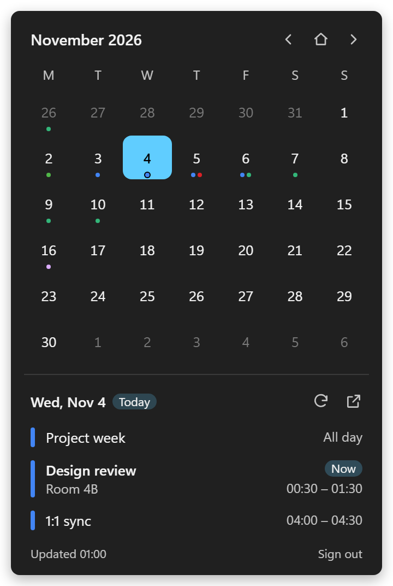

# Seelen Calendar Agenda

English · [简体中文](README.zh-CN.md)

A [Seelen UI](https://github.com/eythaann/Seelen-UI) widget that replaces the top-bar calendar popup with one that shows your **Google Calendar** events.



Seelen UI's built-in calendar popup is a plain month view, and there is no Google Calendar integration in the Seelen resource store. This widget adds one.

## Features

- Opens from the date in the top bar, like the built-in popup
- Month grid with up to three colored dots on days that have events; the first day of the week follows Seelen's setting
- Pick a day to list its events: all-day first, multi-day events split per day (`21:00 →` / `All day` / `→ 07:00`), past events dimmed, current ones marked **Now**
- Reads every calendar you have ticked in Google Calendar; declined and cancelled events are hidden (declined can be shown)
- Click an event to open it in Google Calendar, or ↗ to open the selected day
- `Esc` or clicking elsewhere closes it; English and Chinese UI follow Seelen's language; colors follow the Seelen theme and Windows accent color
- Read-only: requests only the `calendar.readonly` scope

## Requirements

- Seelen UI (tested with 2.8.10)
- Your own Google OAuth client of type **Desktop app**. Every user creates their own; this project does not ship one.

## Install

1. Download `uranus92-gcal-agenda-v*.zip` from [Releases](https://github.com/SherlockChiang/seelen-calendar-agenda/releases) and extract it into `%APPDATA%\com.seelen.seelen-ui\widgets\`, so you get a `uranus92-gcal-agenda` folder there.
2. Restart Seelen UI.
3. Right-click an empty part of the top bar → **Modules**, tick **Date (Google Calendar)** and untick the built-in **Calendar**. The new item is added at the right end; drag it to the middle.
4. The first time you click it, Seelen asks whether **Google Calendar Agenda** may control other applications' windows. Seelen asks this of any third-party popup, because the popup has to bring its own window to the front. Allow it, or the popup can't take focus, close with `Esc`, or hide when you click elsewhere.

## Connect Google Calendar

### Create an OAuth client (once)

1. In [Google Cloud Console](https://console.cloud.google.com/apis/credentials), pick or create a project and enable the **Google Calendar API**.
2. On the OAuth consent screen, add the `https://www.googleapis.com/auth/calendar.readonly` scope and add your account as a test user.
3. Create an OAuth client of type **Desktop app** and note its client ID and client secret.

### Sign in

1. Open the popup and click **Open Seelen settings**. It opens this widget's settings page. Enter the **client ID** and **client secret**, then click **Save** (top right).
2. Open the popup again and click **Sign in with Google**, then approve access in the browser.
3. The browser ends on a page that doesn't load (`http://127.0.0.1:…/?state=…&code=…`). Copy its full address.
4. Paste it into **Authorization response** on the settings page and click **Save**. The widget checks `state`, exchanges the code with PKCE, and loads your events.

Seelen's settings page only applies changes after **Save**. A sign-in attempt is valid for 30 minutes.

Notes:

- While the consent screen is in *Testing*, Google expires refresh tokens after 7 days; the popup then asks you to sign in again.
- Google Workspace (work or school) admins can block unverified apps from calendar access.

## Privacy and security

- Data goes only between your PC and Google. There is no server of ours.
- Tokens are stored in `%APPDATA%\com.seelen.seelen-ui\data\uranus92-gcal-agenda\` (`auth.json`, in plain text; `cache.json` holds the current month's events). Seelen gives each widget its own folder; the shared `localStorage` of third-party widgets is not used.
- The client ID and secret are stored in Seelen's `settings.json` in plain text. A Desktop client secret is not confidential; PKCE protects the sign-in.
- **Sign out** in the popup deletes these files and revokes the token at Google.
- Event titles and locations come from other people's invites, so they are rendered as text, never HTML. Only `https://calendar.google.com` / `https://www.google.com` links are opened.

## How it works

| Constraint (checked on Seelen UI 2.8.10) | Approach |
| --- | --- |
| Widgets run in WebView2 at `http://tauri.localhost` with the same-origin policy on | Google's ICS feeds send no CORS headers, so a widget **cannot read ICS**. The Calendar API (`www.googleapis.com`) and the token endpoint (`oauth2.googleapis.com`) do allow that origin, so the widget calls the API directly. |
| A widget cannot listen on a local port for the OAuth redirect | Desktop OAuth client + PKCE with a random `http://127.0.0.1:<port>/` redirect; the user pastes the final address into the widget's settings |
| The popup hides when it loses focus (for example while you copy from the browser) | The pasted address goes into a Seelen settings field. The widget listens for settings changes and also checks a saved address the next time it opens. |
| All third-party widgets share one `localStorage` origin | Tokens go to the per-widget data folder via Seelen's `read_data_file` / `write_data_file` |

## Development

Requires Node.js 22.18+ (tests run TypeScript directly with Node's type stripping).

```bash
npm install
```

```bash
npm test
```

```bash
npm run typecheck
```

```bash
npm run preview
```

`npm run preview` serves <http://127.0.0.1:5199/dev/index.html>. It renders the popup in several states with a mock Seelen runtime and fake Google responses (`dev/mock-lib/`), so you need neither Seelen nor a Google account. In a frame's console, `__preview.trigger()`, `__preview.setConfig({...})` and `__preview.simulateRedirect()` act like the toolbar click, a settings change and a pasted redirect.

Install into your Seelen (it reloads widgets automatically, no restart needed):

```bash
npm run install-widget
```

```bash
npm run uninstall-widget
```

Build the release zip into `dist/`:

```bash
npm run package
```

Build the Seelen store upload file into `dist/` (needs Seelen UI running); the images and listing text are in [`docs/store/`](docs/store/listing.md):

```bash
npm run bundle
```

`widget/toolbar-plugin.yml` triggers the popup with `${self.id}`, which Seelen resolves to the widget's real ID: `@uranus92/gcal-agenda` for a folder install, the marketplace UUID for a store install. A store install keeps its settings and sign-in separately from a folder install.

Session-only loading through the `slu` CLI is also available: `npm run load` / `npm run reload` / `npm run unload`. You can also open the popup directly with `slu.exe widget trigger @uranus92/gcal-agenda`; with the popup focused, `Ctrl+Shift+I` opens DevTools. Seelen's log is `%LOCALAPPDATA%\com.seelen.seelen-ui\logs\Seelen UI.log`; search for `gcal-agenda`.

Seelen UI 2.8.10 quirks found while building this:

- `slu.exe resource load` hands the path to the running Seelen process, which resolves relative paths against its own working directory. Pass absolute paths (the scripts do).
- In PowerShell, `slu` is a built-in alias for `Set-LocalUser`. Type `slu.exe`.
- Seelen ignores directory-level file-watcher events, so `install-widget` rewrites `metadata.yml` after swapping the folder in, to trigger the reload.
- When widgets change at runtime, Seelen re-sends the widget list but not the plugin list, so a newly installed toolbar plugin only shows up in **Modules** after the toolbar restarts. Turn the Fancy Toolbar off and on in settings, or restart Seelen.
- Changing a widget's `preset` while Seelen runs keeps the old window and its flags; restart Seelen.

### Project layout

```
src/agenda.ts     pure logic: event normalization, month grid, day dots, per-day items, link checks
src/oauth.ts      PKCE, auth URL, redirect parsing, token exchange and refresh
src/calendar.ts   Calendar API: calendarList + events (paged; one failing calendar doesn't break the rest)
src/i18n.ts       English / Chinese strings and date formatting
src/store.ts      per-widget data files
src/main.ts       widget entry: lifecycle, state, rendering
widget/           Seelen resource folder (metadata.yml, toolbar-plugin.yml, index.html, index.css; index.js is built)
dev/              browser preview with a mock Seelen runtime
scripts/          install, package and slu helpers
test/             node:test unit tests
```

## License

[GNU AGPL-3.0](LICENSE). The built widget bundles [`@seelen-ui/lib`](https://www.npmjs.com/package/@seelen-ui/lib), which is AGPL-3.0-only.
