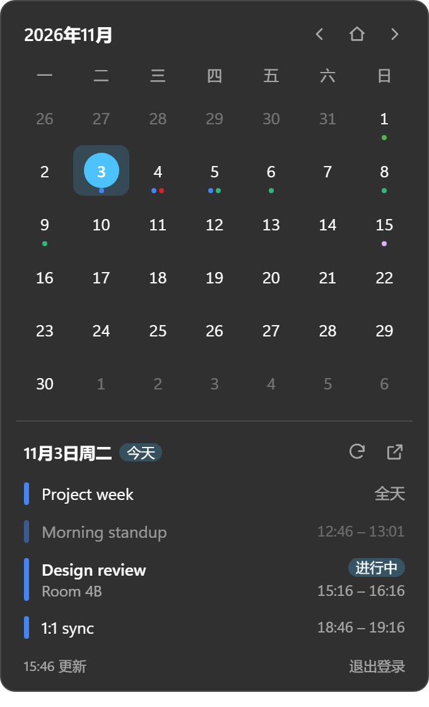

# Seelen Calendar Agenda

[English](README.md) · 简体中文

一个 [Seelen UI](https://github.com/eythaann/Seelen-UI) 小组件：把顶栏点击日期弹出的日历，换成能显示 **Google 日历** 日程的版本。



Seelen UI 自带的日历弹窗只是一个月历，Seelen 资源商店里也没有 Google 日历集成，所以做了这个。

## 功能

- 和自带弹窗一样，点击顶栏日期打开
- 月历中有日程的日子下方显示最多 3 个颜色点；一周从哪天开始跟随 Seelen 的设置
- 点击某一天查看当天日程：全天日程排在最前，跨天日程按天拆分（`21:00 →` / `全天` / `→ 07:00`），已结束的变淡，正在进行的标“进行中”
- 读取你在 Google 日历中勾选的所有日历；默认隐藏已拒绝和已取消的日程（已拒绝的可以设置为显示）
- 点击日程在 Google 日历中打开，点 ↗ 打开所选日期
- 按 `Esc` 或点到别处即关闭；中文 / 英文界面跟随 Seelen 语言，颜色跟随 Seelen 主题和 Windows 强调色
- 只读：只申请 `calendar.readonly` 权限

## 要求

- Seelen UI（已在 2.8.10 上测试）
- 你自己的 **桌面应用 (Desktop app)** 类型 Google OAuth 客户端。每个用户自己创建，本项目不内置。

## 安装

1. 从 [Releases](https://github.com/SherlockChiang/seelen-calendar-agenda/releases) 下载 `sherlockchiang-gcal-agenda-v*.zip`，解压到 `%APPDATA%\com.seelen.seelen-ui\widgets\`，解压后那里应有一个 `sherlockchiang-gcal-agenda` 文件夹。
2. 重启 Seelen UI。
3. 在顶栏空白处右键 → **模块**，勾选 **日期（Google 日历）**，取消勾选自带的 **日历**。新模块会加在最右边，把它拖到中间。
4. 第一次点击时，Seelen 会询问是否允许「Google 日历日程」控制其他应用程序的窗口。所有第三方弹窗都会被这样询问，因为弹窗需要把自己的窗口切到前台。请选择允许，否则弹窗拿不到焦点，`Esc` 和点到别处自动关闭都会失效。

## 连接 Google 日历

### 创建 OAuth 客户端（只需一次）

1. 在 [Google Cloud Console](https://console.cloud.google.com/apis/credentials) 中选择或创建一个项目，启用 **Google Calendar API**。
2. 在 OAuth 同意屏幕中加入 `https://www.googleapis.com/auth/calendar.readonly` 作用域，并把自己的账号加为测试用户。
3. 创建一个 **桌面应用** 类型的 OAuth 客户端，记下客户端 ID 和客户端密钥。

### 登录

1. 打开弹窗，点击 **打开 Seelen 设置**，会直接进入本小组件的设置页。填入 **客户端 ID** 和 **客户端密钥**，点右上角 **保存**。
2. 再打开弹窗，点击 **使用 Google 登录**，在浏览器中同意授权。
3. 浏览器最后会停在一个打不开的页面（`http://127.0.0.1:…/?state=…&code=…`），复制它的完整地址。
4. 粘贴到设置页的 **授权回调地址**，点 **保存**。小组件会校验 `state`、用 PKCE 换取令牌，然后加载日程。

Seelen 设置页要点 **保存** 才生效。一次登录尝试 30 分钟内有效。

注意：

- 同意屏幕处于“测试”状态时，Google 签发的 refresh token 7 天后失效，到时弹窗会提示重新登录。
- Google Workspace（公司或学校）账号的管理员可能禁止未经验证的应用访问日历。

## 隐私与安全

- 数据只在你的电脑和 Google 之间传输，没有任何开发者服务器。
- 令牌保存在 `%APPDATA%\com.seelen.seelen-ui\data\sherlockchiang-gcal-agenda\`（`auth.json`，明文；`cache.json` 存当月日程）。Seelen 为每个小组件分配独立文件夹，不使用第三方小组件共用的 `localStorage`。
- 客户端 ID 和密钥以明文保存在 Seelen 的 `settings.json` 中。桌面客户端的密钥不属于机密，登录由 PKCE 保护。
- 弹窗里的 **退出登录** 会删除这些文件，并向 Google 吊销令牌。
- 日程标题和地点可能来自别人的邀请，因此一律按纯文本显示，不当作 HTML。只会打开 `https://calendar.google.com` / `https://www.google.com` 的链接。

## 实现思路

| 约束（已在 Seelen UI 2.8.10 上核实） | 做法 |
| --- | --- |
| 小组件运行在 `http://tauri.localhost` 的 WebView2 中，开启了同源策略 | Google 的 ICS 地址不返回 CORS 头，**小组件读不了 ICS**；而 Calendar API（`www.googleapis.com`）和令牌端点（`oauth2.googleapis.com`）允许该来源，所以直接调用 Calendar API |
| 小组件无法监听本地端口接收 OAuth 回调 | 使用桌面 OAuth 客户端 + PKCE，回调到随机的 `http://127.0.0.1:端口/`，由用户把最终地址粘贴到设置里 |
| 弹窗失去焦点会自动隐藏（比如去浏览器复制地址时） | 粘贴到 Seelen 设置页的文本框中。小组件监听设置变化，下次打开时也会检查已保存的地址 |
| 所有第三方小组件共用同一个 `localStorage` 来源 | 令牌通过 Seelen 的 `read_data_file` / `write_data_file` 存到按小组件隔离的数据目录 |

## 开发

需要 Node.js 22.18+（测试直接用 Node 的类型擦除运行 TypeScript）。

```bash
npm install
```

```bash
npm test
```

```bash
npm run typecheck
```

```bash
npm run preview
```

`npm run preview` 在 <http://127.0.0.1:5199/dev/index.html> 启动预览页。它用 `dev/mock-lib/` 模拟 Seelen 运行时和 Google 接口，同时展示几种状态，不需要 Seelen，也不需要 Google 账号。在某个预览框的控制台里，`__preview.trigger()`、`__preview.setConfig({...})`、`__preview.simulateRedirect()` 分别模拟点击顶栏、修改设置和粘贴回调地址。

安装到 Seelen（Seelen 会自动重新加载小组件，不用重启）：

```bash
npm run install-widget
```

```bash
npm run uninstall-widget
```

在 `dist/` 生成发布用的 zip：

```bash
npm run package
```

在 `dist/` 生成 Seelen 商店上传文件（需要 Seelen UI 正在运行）；图片和商店文案在 [`docs/store/`](docs/store/listing.md)：

```bash
npm run bundle
```

`widget/toolbar-plugin.yml` 用 `${self.id}` 打开弹窗，Seelen 会把它替换成小组件的实际 ID：从文件夹安装时是 `@sherlockchiang/gcal-agenda`，从商店安装时是商店分配的 UUID。商店版的设置和登录状态与文件夹版相互独立。

也可以用 `slu` 命令临时加载，只在本次 Seelen 运行期间有效：`npm run load` / `npm run reload` / `npm run unload`。也可以用 `slu.exe widget trigger @sherlockchiang/gcal-agenda` 直接打开弹窗；弹窗获得焦点时按 `Ctrl+Shift+I` 打开 DevTools。Seelen 日志在 `%LOCALAPPDATA%\com.seelen.seelen-ui\logs\Seelen UI.log`，搜索 `gcal-agenda`。

开发中发现的 Seelen UI 2.8.10 行为：

- `slu.exe resource load` 会把路径交给正在运行的 Seelen 进程，相对路径按 Seelen 自己的工作目录解析，所以要传绝对路径（脚本已处理）。
- 在 PowerShell 里 `slu` 是内置命令 `Set-LocalUser` 的别名，要写 `slu.exe`。
- Seelen 的文件监视会忽略文件夹级别的事件，所以 `install-widget` 换入文件夹后会重写一次 `metadata.yml` 来触发重新加载。
- 运行中的小组件发生变化时，Seelen 只重新发送部件列表，不发送插件列表，所以新装的顶栏插件要等顶栏重启后才会出现在 **模块** 菜单里。可以在设置中把“精美工具栏”关掉再打开，或者重启 Seelen。
- 运行中修改小组件的 `preset`，Seelen 会沿用旧窗口及其属性，需要重启 Seelen。

### 项目结构

```
src/agenda.ts     纯逻辑：事件归一化、月历网格、每日颜色点、当天日程、链接校验
src/oauth.ts      PKCE、授权 URL、回调解析、换取与刷新令牌
src/calendar.ts   Calendar API：calendarList + events（分页；单个日历失败不影响其他）
src/i18n.ts       中英文文案与日期格式
src/store.ts      按小组件隔离的数据文件读写
src/main.ts       小组件入口：生命周期、状态、渲染
widget/           Seelen 资源目录（metadata.yml、toolbar-plugin.yml、index.html、index.css；index.js 为构建产物）
dev/              浏览器预览（模拟 Seelen 运行时）
scripts/          安装、打包与 slu 辅助脚本
test/             node:test 单元测试
```

## 许可证

[GNU AGPL-3.0](LICENSE)。构建出的小组件内置了 AGPL-3.0-only 许可的 [`@seelen-ui/lib`](https://www.npmjs.com/package/@seelen-ui/lib)。
